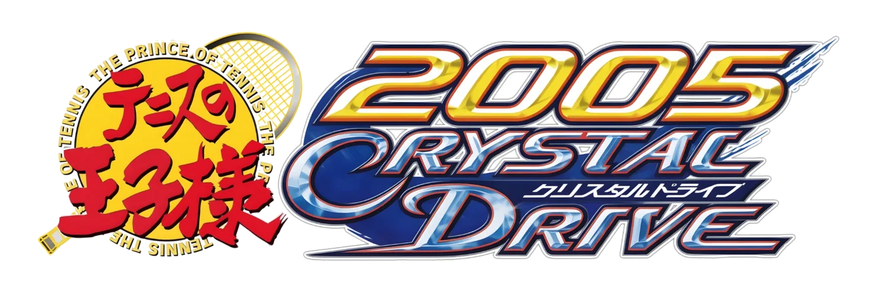

<p align="center">
  
</p>

<h1 align="center">Tennis no Ouji-sama 2005 CRYSTAL DRIVE Decompilation</h1>

[](https://bytematch.dev/RyonaEc/Tennis-no-Ouji-sama-2005-Crystal-Drive-Decompilation)
[](https://bytematch.dev/RyonaEc/Tennis-no-Ouji-sama-2005-Crystal-Drive-Decompilation)

A work-in-progress matching decompilation of *テニスの王子様 2005 CRYSTAL DRIVE*
(Nintendo DS, Japan), built on [`ds-decomp`](https://github.com/AetiasHax/ds-decomp).

The goal is source that compiles with the original CodeWarrior toolchain into a
ROM that matches the retail release byte for byte.

| | |
|---|---|
| Title | テニスの王子様 2005 CRYSTAL DRIVE |
| Game code | `NTR-ATOJ-JPN` (`ATOJ`) |
| Publisher / developer | Konami / KCEJ |
| Release | 2004-12-30 |
| Cartridge | 512 Mbit (64 MiB) |
| Target | ARM9 (ARM946E-S), ARM7, overlays |
| Supported dump | `sha1: 8d555a80db47278475ffdfdf808fe80dbd7c48cf` (64 MiB) |

## Status

The toolchain works end to end: the delinked build links and rebuilds a
byte-for-byte identical ROM, including all eleven ARM9 overlays.

```
$ ninja sha1
Target: 8d555a80db47278475ffdfdf808fe80dbd7c48cf; tennis_ATOJ.nds: 8d555a80db47278475ffdfdf808fe80dbd7c48cf
tennis_ATOJ.nds: OK
```

1,475 functions (101,376 bytes) in the ARM9 main module and its overlays now match
C source compiled with `mwccarm` 1.2/sp2 (and 1.2/b56 for the units retail built
with it) and linked into the original addresses,
and the rebuilt ROM still hashes to the retail dump. `ninja report` shows `matched_functions: 1,475` of 3,806 (38.75%) and
`matched_code: 101,376` of 1,841,700 bytes (5.50%); the other 2,331 functions are
still delinked assembly. [PROGRESS.md](PROGRESS.md) has the fuller breakdown
(code, functions, fuzzy match, data, unit completeness, and a per-module table);
`python build/progress.py` regenerates it.

Everything below needs your own dump of the cartridge. No ROM or BIOS image is
included in this repository.

## Setup

### Prerequisites

* Python 3.10+
* [Ninja](https://ninja-build.org/) (`python -m pip install ninja`)
* Windows, or Linux with [Wibo](https://github.com/decompals/wibo) (downloaded automatically)

The 32-bit CodeWarrior compilers are downloaded automatically. See
[docs/SETUP.md](docs/SETUP.md) if you would rather supply your own.

### 1. Provide the base ROM

Put your dump anywhere under `extract/` - the file name does not matter, and an
encrypted dump is fine - or pass its path explicitly:

```shell
python tools/init.py "extract/Tennis no Ouji-sama 2005 CRYSTAL DRIVE.nds"
```

`init.py` checks the secure area: an encrypted dump is decrypted with your
`arm7_bios.bin` (also looked for as `bios7.bin` or `extract/arm7_bios.bin`), and
an already-decrypted dump needs no BIOS at all. See
[docs/SETUP.md](docs/SETUP.md#roms-and-bios).

### 2. Extract and initialise

```shell
python tools/init.py
```

This verifies the ROM header, records your dump's SHA-1 in
`config/ATOJ/tennis_ATOJ.sha1`, extracts code and assets with `dsd rom extract`,
and generates `config/ATOJ/` with delinks, symbols and relocations.

### 3. Configure and build

```shell
python tools/configure.py ATOJ
ninja
```

`ninja` builds `tennis_ATOJ.nds` from the delinked objects. At this stage the
result should already match the base ROM, which proves the toolchain and link
layout before any C is written.

## Targets

| Command | Result |
|---|---|
| `ninja rom` | Link `build/ATOJ/arm9.o` and build `tennis_ATOJ.nds` |
| `ninja check` | Verify every module against the base ROM (`dsd check`) |
| `ninja sha1` | Compare the built ROM's SHA-1 with `config/ATOJ/tennis_ATOJ.sha1` |
| `ninja objdiff` | Generate `objdiff.json` for [objdiff](https://github.com/encounter/objdiff) |
| `ninja report` | Per-function progress report (`build/ATOJ/report.json`) |
| `ninja delink` | Re-delink the base ROM after editing `delinks.txt` |
| `ninja dis` | Disassemble the base ROM into `build/ATOJ/asm/` |
| `ninja apply` | Copy symbol data from the linked ELF back into `symbols.txt` |
| `ninja download_tools` | Fetch `dsd`, `mwccarm`, `sjiswrap`, `objdiff` (and `wibo`) |

## Layout

```
config/ATOJ/        dsd configuration: per-module delinks, symbols, relocs
src/                decompiled C/C++ (one translation unit per delinked file)
include/            shared headers
libs/               vendored libraries (headers are added to the include path)
tools/              extraction, build and matching tooling
extract/            your ROM and its extraction (never committed)
build/ATOJ/         delinked objects, linker script, EFX and the built ROM
```

## Matching notes

[`notes/mwccarm-codegen.md`](notes/mwccarm-codegen.md) is the project's codegen
playbook: which source shapes make `mwccarm` emit which instructions on this
title (addressing modes, register colouring, branch versus predication,
signedness), a symptom-to-lever table, the workflow that gates a match, and the
walls hit so far together with the evidence that they cannot be reached from
source. It is written to be reusable on other DS titles built with the same
compiler.

If you are an AI agent contributing to this repository, read
[`AGENTS.md`](AGENTS.md) first: it states what counts as a finished unit, the
hard rules that keep the ROM matching, the edit loop and the helper scripts in
`build/`, and how to commit and publish a batch.

## Legal

This project reverse-engineers the game for preservation and research. It ships
no game code, assets, ROMs or BIOS images. You must supply your own legally
obtained dump. *Tennis no Ouji-sama*
and all related marks are property of their respective owners.
